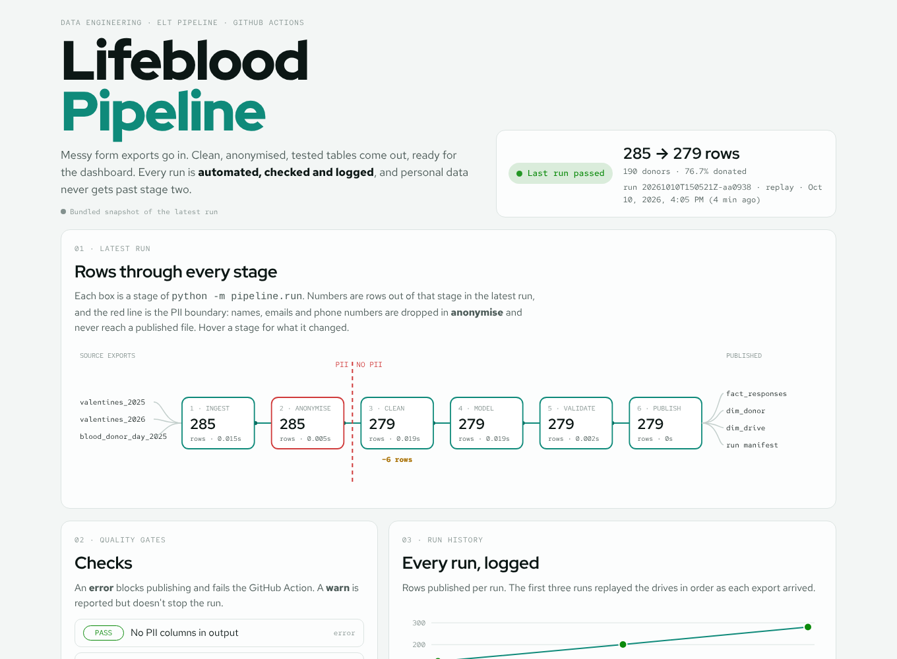

# Lifeblood Pipeline

**An automated ELT pipeline that turns messy blood-drive form exports into clean, anonymised, tested tables, then publishes them through GitHub Actions.**

Track: Data Engineering · Python, pandas, YAML config, pytest, GitHub Actions · [Live control room](https://qaisbello.github.io/data-engineering/lifeblood-pipeline/)



## Why it exists

[Lifeblood Ledger](https://github.com/QaisBello/One-health-life-savers-blood-ledger) began as a one-off cleaning script for One Health Lifesavers' blood drives. Every new drive meant re-running it by hand and re-checking the output by eye. This repo turns that script into a pipeline. A new export goes in, and tested tables, a quality log and a run record come out with no manual steps. Personal data is removed at stage two and never written to a published file.

## How it works

```
samples/incoming/*.csv ─► ingest ─► anonymise ─┆─► clean ─► model ─► validate ─► publish
                                               ┆
                                 PII boundary: names, emails and phones stop here
```

| Stage | What it does |
|---|---|
| **ingest** | Finds each drive's export by filename pattern and maps each form's column wording to canonical names using the aliases in `config.yml`. |
| **anonymise** | Links the same person across drives by phone or email (union-find), assigns a keyed HMAC `donor_id`, then drops all four PII columns. |
| **clean** | Re-assigns responses submitted on the wrong drive's form (by date), removes duplicate submissions, blanks implausible ages, groups free-text institutions and classifies free-text deferral reasons. |
| **model** | Builds a star schema: `fact_responses`, `dim_donor`, `dim_drive`. |
| **validate** | Runs the quality gates. An `error` failure stops the run before anything is published. A `warn` failure is logged. |
| **publish** | Writes the tables to `data/published/`, the change log to `data_quality_log.csv`, and the run record to `runs/latest.json` and `runs/history.json`. |

### Quality gates

| Check | Level |
|---|---|
| No PII columns in output | error |
| One row per donor per drive | error |
| Every row maps to a known drive | error |
| Ages within valid range or blank | error |
| Deferral reason set for every non-donation | warn |
| Donation rate between 30% and 95% | warn |

### Automation (`.github/workflows/pipeline.yml`)

1. **Trigger:** a new export pushed to `samples/incoming/`, a change to `pipeline/`, every Monday at 06:17 UTC, or a manual run.
2. **Test:** `pytest` runs first. A broken stage never touches the data.
3. **Run:** `python -m pipeline.run`, with `PIPELINE_SECRET` read from GitHub Secrets.
4. **Commit:** the published tables and run manifest are committed back to the repo. The control-room page reads them live from GitHub.

## Design decisions

- **Config, not code, for change.** A new drive is one line under `drives:` in `config.yml`. A reworded form question is one new alias. Institution groups and deferral-reason patterns are also in config.
- **Keyed IDs.** `donor_id` is an HMAC of the phone or email under a secret key. IDs stay stable across runs, so a returning donor keeps the same ID, but without the key they cannot be reversed by hashing a list of phone numbers. A plain or salted hash can be reversed that way.
- **Every change is logged.** Each stage writes what it changed, how many rows and why. That log is published as `data_quality_log.csv` and shown on the control-room page.
- **A failed gate fails loudly.** `run.py` exits non-zero on an error-level failure, so the GitHub Action goes red and nothing is committed.

## The data in this repo is synthetic

`samples/generate.py` creates three fake exports (125, 80 and 80 rows) that mimic the real forms' structure and mess: misfiled responses, duplicates, blank genders, free-text institutions and reasons. Phones are `0800000xxxx` and emails use `@example.com`. **No real person is in this repo.**

The same pipeline runs on the real One Health Lifesavers exports privately, with a real secret key. `.gitignore` excludes `*.xlsx` and `incoming_private/` so real exports cannot be committed by accident.

## Latest run (synthetic)

| | |
|---|---|
| Rows in → out | 285 → 279 |
| Donors | 190 |
| Checks | 5 pass, 1 warn |
| History | 3 replayed runs: 125→122, 205→199, 285→279 |

## Power BI version

The same project as a ready-made Power BI report, in [`powerbi/`](powerbi/): the control room (latest run, stages, quality gates, change log, run history, parsed from the JSON run records) and the published data. Open `powerbi/Lifeblood_Pipeline.pbip` in Power BI Desktop and click Refresh; it reads this repo's data from GitHub.

## Run it locally

```bash
pip install -r requirements.txt pytest
python samples/generate.py          # optional: regenerate the synthetic exports
python -m pytest -q tests           # 4 tests
python -m pipeline.run              # or: --incoming <dir> --out <dir>
python build.py                     # rebuild web/index.html
```

Set `PIPELINE_SECRET` to use your own key. Without it, a development key is used and IDs are only stable on your machine.

## Tests

| Test | Proves |
|---|---|
| `test_end_to_end_publishes_without_pii` | A full run publishes all tables and no PII column survives. |
| `test_misfiled_responses_are_reassigned` | Responses on the wrong drive's form are moved by date. |
| `test_ids_are_stable_and_key_dependent` | Same key gives the same IDs; a different key gives different IDs. |
| `test_failed_check_blocks_publish` | An error-level failure exits non-zero and publishes nothing. |

## Repo layout

```
pipeline/   config.yml · stages.py · run.py
samples/    generate.py · incoming/ (synthetic exports)
data/       published/ (tables + data_quality_log.csv)
runs/       latest.json · history.json
tests/      test_pipeline.py
web/        template.html → index.html (control room)
.github/    workflows/pipeline.yml
```

---

Built by [Qais Adeniji-Bello](https://qaisbello.github.io) · [LinkedIn](https://www.linkedin.com/in/qais-adeniji-bello/)
